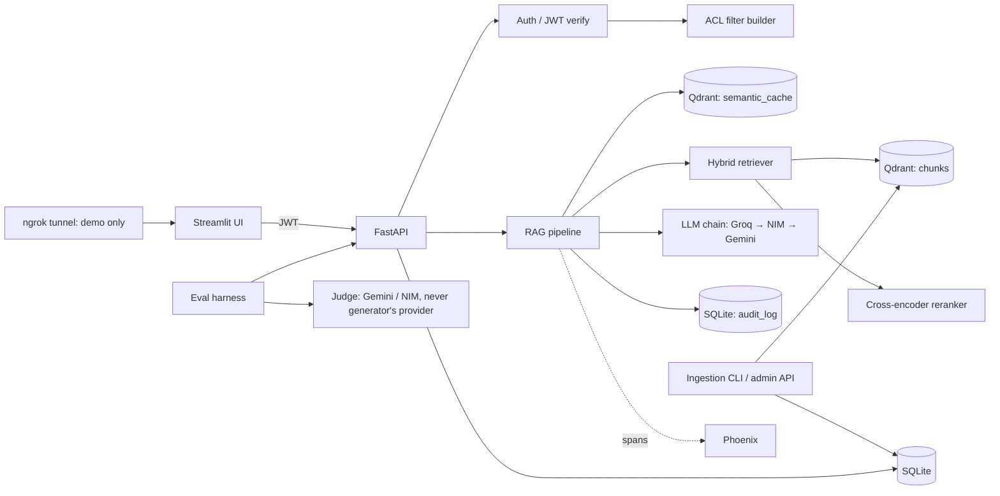

# SDP Review-2 Content — PermRAG

**Course:** Senior Design Project (20ECSW401) | **Semester:** 07 | **Year:** 2026–27

**Project Title:** PermRAG — Permission-Aware Multi-Tenant Retrieval-Augmented Generation System

---

## Table of Contents

1. [Deliverable 1 — System Requirements](#deliverable-1--system-requirements)
2. [Deliverable 2 — Architectural Framework / System Model](#deliverable-2--architectural-framework--system-model)
3. [Deliverable 3 — Detailed Design (Design Patterns, UX, APIs)](#deliverable-3--detailed-design-design-patterns-ux-apis)
4. [Deliverable 4 — Detailed Design with Constraints (Algorithms / Pseudocode / Mathematical Models)](#deliverable-4--detailed-design-with-constraints)
5. [Deliverable 5 — Tools for Design and Implementation](#deliverable-5--tools-for-design-and-implementation)
6. [Deliverable 6 — Module Implementation & Integration](#deliverable-6--module-implementation--integration)

---

## Deliverable 1 — System Requirements

> **Expectation:** Prepare system requirements based on the review of literature.
> **Deliverable:** Functional and Non-functional requirements.

### 1.1 Literature Review Summary

The project builds on the following identified gaps in the current research landscape:

| Gap ID | Research Gap | Key Prior Work |
|--------|-------------|----------------|
| G1 | No benchmark exists for **authorization leakage** in multi-tenant RAG systems | LeakDojo (arXiv 2605.05818), KDD 2026 extraction benchmark |
| G2 | Enforcement points (none, prompt-only, post-filter, pre-filter, LLM-filter) have never been compared under a single controlled protocol | Martinelli & Ponti (BRACIS 2025) argue for RBAC retrieval filter; ARBITER (arXiv 2512.20535) uses LLM-based layered filtering |
| G3 | No study examines a semantic response cache inside a permission-aware RAG pipeline | — |
| G4 | Leakage through aggregation over authorized content is not measured | Burnat (2026) |
| G5 | Existence inference attacks are understudied in RAG | — |
| G6 | Adaptive and colluding adversaries are not benchmarked against authorization controls | LeakDojo adaptive attacks |
| G7 | Utility cost of strict enforcement is not quantified | — |
| G8 | Reliance on small synthetic corpora undermines external validity | EnterpriseRAG-Bench, EnronQA, WixQA |

**Contribution Statement:** A threat model and an open benchmark for *authorization leakage* in multi-tenant RAG (what an authenticated but unauthorized user can obtain), a controlled comparison of enforcement points (S0–S4) and cache modes, evaluation under adaptive extraction attacks, and a measurement of the utility and latency cost of enforcement.

### 1.2 Functional Requirements

| FR ID | Requirement | Priority | User Story |
|-------|-------------|----------|------------|
| FR-01 | **Role-Based Query Answering** — The system shall answer user queries by retrieving only documents that the authenticated user's role, department, and tenant permit. | Must | U1 |
| FR-02 | **Safe Refusal** — When the answer is not in the user's permitted document set, the system shall return the fixed string `"I couldn't find that in the documents available to you."` without revealing whether a restricted document exists. | Must | U2 |
| FR-03 | **Document Ingestion** — Admins shall ingest or re-ingest documents via CLI or API, with ACL metadata drawn from a manifest file (`manifest.jsonl`). | Must | U3 |
| FR-04 | **Audit Logging** — Every query shall produce an append-only audit log entry recording: user identity, question, retrieved chunk IDs, cited chunk IDs, cache hit status, access mode, latency, and an answer hash. | Must | U4 |
| FR-05 | **Persona Switching** — A demo UI shall allow switching between pre-seeded user personas (intern, employee, manager, admin across 3 tenants) to demonstrate differential access to the same query. | Must | U5 |
| FR-06 | **Evaluation Harness** — The system shall provide a CLI to run benchmark evaluations across enforcement modes (S0–S4) and produce metrics for retrieval quality, security, and latency. | Must | U6 |
| FR-07 | **User Feedback** — Users shall provide thumbs-up/down feedback on answers, stored with the corresponding request ID. | Should | U7 |
| FR-08 | **Citation Validation** — Every generated answer shall cite context passages with `[S#]` markers. Invalid citations are stripped; answers with zero valid citations are replaced with the refusal string. | Must | — |
| FR-09 | **JWT Authentication** — Users shall authenticate via email/password login and receive a JWT (HS256, 60-min expiry) carrying `sub`, `tenant_id`, `department`, `role_level` claims. | Must | — |
| FR-10 | **Idempotent Re-ingestion** — Re-ingesting an unchanged document shall be a no-op (0 writes), verified by content hash comparison. | Must | — |
| FR-11 | **Semantic Cache** — Repeated or paraphrased queries shall be answered from a tenant-and-permission-scoped semantic cache with cosine threshold ≥ 0.92 and 24-hour TTL. | Should | — |
| FR-12 | **Streaming Responses** — `POST /query/stream` shall return Server-Sent Events for real-time token streaming. | Should | — |
| FR-13 | **Health Check** — `GET /health` shall report the status of Qdrant and LLM connectivity. | Must | — |

### 1.3 Non-Functional Requirements

| NFR ID | Category | Requirement | Metric / Threshold |
|--------|----------|-------------|-------------------|
| NFR-01 | **Security** | Pre-retrieval ACL filter must be applied inside every vector search call. No code path touches the vector store without a filter built from the authenticated user's JWT. | RLR = 0, ALR = 0, CLR = 0 on system S3 |
| NFR-02 | **Performance** | End-to-end query latency (p95) shall not exceed 6 seconds on the primary LLM provider. | p95 ≤ 6 s |
| NFR-03 | **Performance** | Retrieval-only latency (embedding + vector search + reranking) shall stay under 540 ms (p95). | p95 ≤ 540 ms |
| NFR-04 | **Accuracy** | Retrieval quality (Recall@6) shall be ≥ 0.85 on the authorized QA set. | Recall@6 ≥ 0.85 |
| NFR-05 | **Accuracy** | Mean faithfulness score (LLM-judged, 1–5 scale) shall be ≥ 4.0. | Faithfulness ≥ 4.0 |
| NFR-06 | **Accuracy** | Over-refusal on answerable questions shall be ≤ 10%. | Over-refusal ≤ 10% |
| NFR-07 | **Utility** | Utility drop (Recall@6) from S0 (no filter) to S3 (pre-filter) shall be ≤ 5 percentage points. | ΔRecall@6 ≤ 5 pts |
| NFR-08 | **Scalability** | The system shall handle a synthetic corpus of ~180 documents (~1,200–1,800 chunks) on a single node without GPU. | Single-node, CPU-only |
| NFR-09 | **Availability** | LLM provider failure shall trigger automatic fallback (Groq → NVIDIA NIM → Google Gemini) with up to 3 retries per provider, exponential backoff 1s–8s. | 3 providers, 3 retries each |
| NFR-10 | **Rate Limiting** | API shall enforce 30 requests/min/user. | 429 on exceed |
| NFR-11 | **Data Privacy** | The corpus is 100% synthetic. No real PII. Audit log stores answer hashes, not plaintext answers. API keys never appear in the corpus or logs. | PII scan passes in CI |
| NFR-12 | **Maintainability** | All model IDs and endpoints shall live in `.env` configuration; changing a model is a config edit, not a code change. | Config-driven |
| NFR-13 | **Reproducibility** | Every reported result shall be a mean ± std over at least 3 seeds, with provider, model ID, and run date recorded. | ≥ 3 seeds |
| NFR-14 | **Cost** | The system shall operate entirely within free-tier API limits ($0 budget). No paid APIs nor GPU required. | $0 operational cost |

### 1.4 Constraints

| ID | Constraint |
|----|-----------|
| C1 | No GPU, no local LLM serving, no paid APIs. |
| C2 | No fine-tuning or model training of any kind. |
| C3 | No real or personal data — corpus is 100% synthetic. |
| C4 | No OCR, scanned PDFs, images, tables-as-structure, or audio. |
| C5 | No multi-turn memory or query rewriting (leakage channel risk). |
| C6 | No SSO/OAuth/SAML — local JWT only. |
| C7 | Single-node deployment (no horizontal scaling). |
| C8 | Python 3.11+ only. |

### 1.5 Assumptions

1. Free-tier LLM APIs (Groq, NVIDIA NIM, Google Gemini) will remain available with sufficient rate limits for evaluation.
2. The `BAAI/bge-small-en-v1.5` embedding model via `fastembed` (ONNX) runs on CPU at acceptable speed (~60 ms per query).
3. Qdrant's payload filtering within HNSW traversal is functionally equivalent to a pre-retrieval filter for security purposes.
4. Synthetic corpus, despite limitations, is sufficient for comparative security evaluation across enforcement modes.
5. Docker Desktop is available on the development machine.

---

## Deliverable 2 — Architectural Framework / System Model

> **Expectation:** Design a suitable architectural framework / system model.
> **Deliverable:** Architectural diagram.

### 2.1 High-Level System Architecture

```
┌──────────────────────────────────────────────────────────────────────────┐
│                         PermRAG System Architecture                      │
│                                                                          │
│  ┌───────────┐      ┌──────────────┐      ┌──────────────────────────┐  │
│  │  ngrok    │─────▶│ Streamlit UI │─────▶│     FastAPI Backend      │  │
│  │ (demo)    │      │ (Login,      │ JWT  │  ┌────────────────────┐  │  │
│  └───────────┘      │  Persona     │      │  │  API Layer         │  │  │
│                     │  Switcher,   │      │  │  /auth/login       │  │  │
│                     │  Chat,       │      │  │  /query            │  │  │
│                     │  Sources,    │      │  │  /query/stream     │  │  │
│                     │  Audit Tab)  │      │  │  /feedback         │  │  │
│                     └──────────────┘      │  │  /documents        │  │  │
│                                           │  │  /ingest           │  │  │
│                                           │  │  /audit            │  │  │
│  ┌───────────┐                            │  │  /health           │  │  │
│  │ Eval      │───────────────────────────▶│  └────────────────────┘  │  │
│  │ Harness   │                            │           │              │  │
│  │ (pytest,  │                            │           ▼              │  │
│  │  evals/)  │                            │  ┌────────────────────┐  │  │
│  └───────────┘                            │  │ Security Layer     │  │  │
│       │                                   │  │ ┌────────────────┐ │  │  │
│       ▼                                   │  │ │ JWT Verify     │ │  │  │
│  ┌───────────┐                            │  │ │ (pyjwt+bcrypt) │ │  │  │
│  │ LLM Judge │                            │  │ └────────────────┘ │  │  │
│  │ (Gemini/  │                            │  │ ┌────────────────┐ │  │  │
│  │  NIM,     │                            │  │ │ ACL Filter     │ │  │  │
│  │  ≠ gen.)  │                            │  │ │ Builder        │ │  │  │
│  └───────────┘                            │  │ └────────────────┘ │  │  │
│                                           │  └────────────────────┘  │  │
│                                           │           │              │  │
│                                           │           ▼              │  │
│                                           │  ┌────────────────────┐  │  │
│                                           │  │  RAG Pipeline      │  │  │
│                                           │  │  ┌──────────────┐  │  │  │
│                                           │  │  │Cache Lookup  │  │  │  │
│                                           │  │  │(Qdrant cache)│  │  │  │
│                                           │  │  └──────┬───────┘  │  │  │
│                                           │  │         ▼          │  │  │
│                                           │  │  ┌──────────────┐  │  │  │
│                                           │  │  │Hybrid Retriev│  │  │  │
│                                           │  │  │(Dense+Sparse │  │  │  │
│                                           │  │  │ + ACL Filter)│  │  │  │
│                                           │  │  └──────┬───────┘  │  │  │
│                                           │  │         ▼          │  │  │
│                                           │  │  ┌──────────────┐  │  │  │
│                                           │  │  │Reranker      │  │  │  │
│                                           │  │  │(Cross-Encoder│  │  │  │
│                                           │  │  │ 20→6)        │  │  │  │
│                                           │  │  └──────┬───────┘  │  │  │
│                                           │  │         ▼          │  │  │
│                                           │  │  ┌──────────────┐  │  │  │
│                                           │  │  │Context       │  │  │  │
│                                           │  │  │Assembly      │  │  │  │
│                                           │  │  │(Budget 3000t)│  │  │  │
│                                           │  │  └──────┬───────┘  │  │  │
│                                           │  │         ▼          │  │  │
│                                           │  │  ┌──────────────┐  │  │  │
│                                           │  │  │LLM Generate  │  │  │  │
│                                           │  │  │(Groq→NIM→    │  │  │  │
│                                           │  │  │ Gemini)      │  │  │  │
│                                           │  │  └──────┬───────┘  │  │  │
│                                           │  │         ▼          │  │  │
│                                           │  │  ┌──────────────┐  │  │  │
│                                           │  │  │Citation      │  │  │  │
│                                           │  │  │Validation    │  │  │  │
│                                           │  │  └──────────────┘  │  │  │
│                                           │  └────────────────────┘  │  │
│                                           └──────────────────────────┘  │
│                                                    │     │              │
│                              ┌─────────────────────┘     └──────┐       │
│                              ▼                                  ▼       │
│                    ┌──────────────────┐              ┌──────────────┐   │
│                    │    Qdrant        │              │   SQLite      │   │
│                    │  (Docker)        │              │               │   │
│                    │ ┌──────────────┐ │              │ • users       │   │
│                    │ │ {env}_chunks │ │              │ • tenants     │   │
│                    │ │ (dense+sparse│ │              │ • documents   │   │
│                    │ │  + ACL       │ │              │ • chunks      │   │
│                    │ │  payload)    │ │              │ • audit_log   │   │
│                    │ └──────────────┘ │              │ • feedback    │   │
│                    │ ┌──────────────┐ │              │ • conversations│  │
│                    │ │ {env}_       │ │              │ • messages    │   │
│                    │ │ semantic_    │ │              └──────────────┘   │
│                    │ │ cache       │ │                      │          │
│                    │ └──────────────┘ │              ┌──────────────┐   │
│                    └──────────────────┘              │Arize Phoenix │   │
│                                                     │(OTel Tracing)│   │
│                                                     └──────────────┘   │
└──────────────────────────────────────────────────────────────────────────┘
```

### 2.2 Component Diagram (Mermaid)



### 2.3 Data Flow Diagrams

#### (a) Ingestion Data Flow

```
manifest.jsonl ──▶ Load file ──▶ Compute content_hash
                       │
                       ▼
              Compare with existing
                  doc hashes
                   │        │
             (unchanged)  (changed/new)
                   │        │
                   ▼        ▼
                 SKIP    Parse → Clean → Chunk
                              │
                              ▼
                     Embed (dense + sparse)
                              │
                              ▼
                  Delete old chunks (if update)
                              │
                              ▼
                   Upsert to Qdrant with
                     ACL payload metadata
                              │
                              ▼
                Update SQLite documents/chunks
                  Flush affected cache entries
                 Write ingest_runs row
```

#### (b) User Query Data Flow

```
POST /query + JWT
       │
       ▼
  Verify JWT → Extract {user_id, tenant_id, department, role_level}
       │
       ▼
  Rate-limit check (30 req/min/user)
       │
       ▼
  Embed query (dense + sparse)
       │
       ▼
  Cache lookup (tenant + perm_sig filter, cosine ≥ 0.92)
       │                          │
   (cache hit)              (cache miss)
       │                          │
       ▼                          ▼
  Return cached         Build ACL filter from JWT
  answer                      │
       │                      ▼
       │              Hybrid search (filter applied in
       │              BOTH dense and sparse prefetches)
       │                      │
       │                      ▼
       │              RRF Fusion → top 20
       │                      │
       │                      ▼
       │              Cross-encoder rerank → top 6
       │              Per-doc cap (max 3 chunks/doc)
       │                      │
       │                      ▼
       │              if no chunks → REFUSAL STRING
       │              else → Assemble context (3000 token budget)
       │                      │
       │                      ▼
       │              LLM Generate (Groq → NIM → Gemini)
       │                      │
       │                      ▼
       │              Validate citations (strip invalid [S#])
       │                      │
       │                      ▼
       │              Write cache entry + Audit log row
       │                      │
       └──────────────────────┘
                  │
                  ▼
            Return response: {answer, sources[], refused,
                              cache_hit, latency_ms, request_id}
```

### 2.4 Access Control Model

```
role_level: 1 = intern, 2 = employee, 3 = manager, 4 = hr_admin
department: one of {engineering, hr, finance, legal, sales} or "all"
tenant_id:  one of {acme, globex, initech}

A user U may see chunk C iff:
  C.tenant_id == U.tenant_id
  AND C.min_role_level <= U.role_level
  AND (C.department == "all" OR C.department == U.department OR U.role_level == 4)
```

### 2.5 Experiment System Variants

| Mode | System | Behavior | Purpose |
|------|--------|----------|---------|
| `none` | S0 | No filter anywhere | Baseline — maximum recall, zero security |
| `prompt` | S1 | No filter. System prompt told user's role. | Prompt-only defense |
| `post` | S2 | Retrieve unfiltered, drop unauthorized after reranking | Post-retrieval filter |
| `pre` | S3 | Filter inside vector search (default) | Pre-retrieval filter — **the design** |
| `llmfilter` | S4 | ARBITER-style LLM-based approval/rewrite | Probabilistic LLM defense baseline |

---

## Deliverable 3 — Detailed Design (Design Patterns, UX, APIs)

> **Expectation:** Apply suitable design principles (design patterns / UX design / APIs) and select optimal design solutions.
> **Deliverable:** Pictorial representation of design patterns/UX for modules. Structure of APIs.

### 3.1 Design Patterns Applied

#### 3.1.1 Singleton Pattern — Model Management

**Justification:** Embedding models and LLM clients are expensive to initialize. Loading them once at startup and reusing across requests avoids repeated ONNX model loading and API client instantiation.

```
┌──────────────────────────────────────────────────┐
│              Singleton Instances                  │
│                                                   │
│   get_embed_model()  ──▶ EmbeddingModel           │
│        (module-level _embed_model)                │
│                                                   │
│   get_llm_client()   ──▶ LLMClient                │
│        (module-level _llm_client)                 │
│                                                   │
│   get_qdrant_client() ──▶ QdrantClient             │
│        (module-level _qdrant_client)              │
│                                                   │
│   get_engine()        ──▶ SQLAlchemy Engine        │
│        (module-level _engine)                     │
└──────────────────────────────────────────────────┘
```

**Applied in:** `app/rag/embed.py`, `app/rag/generate.py`, `app/rag/store.py`, `app/db/session.py`

#### 3.1.2 Strategy Pattern — Access Control Modes

**Justification:** Five enforcement strategies (S0–S4) must be interchangeable at runtime for the benchmark. The strategy pattern allows switching access control behaviour via configuration without modifying the retrieval pipeline.

```
┌─────────────────┐
│   RAG Pipeline   │
│   answer()       │
│                  │
│ access_mode ─────┼──▶ ┌──────────────────┐
│                  │    │ NoneStrategy (S0) │ ── No filter
│                  │    ├──────────────────┤
│                  │    │ PromptStrategy(S1)│ ── Prompt-only
│                  │    ├──────────────────┤
│                  │    │ PostStrategy (S2) │ ── Post-retrieval filter
│                  │    ├──────────────────┤
│                  │    │ PreStrategy  (S3) │ ── Pre-retrieval filter ✓
│                  │    ├──────────────────┤
│                  │    │ LLMFilter   (S4) │ ── ARBITER-style
│                  │    └──────────────────┘
└─────────────────┘
```

**Applied in:** `app/rag/retriever.py` (mode parameter), `app/rag/pipeline.py`

#### 3.1.3 Builder Pattern — ACL Filter Construction

**Justification:** Qdrant filters are complex nested objects built from user attributes. The builder pattern encapsulates this logic in a single function, ensuring the filter is always constructed correctly.

```
User(tenant_id, department, role_level)
       │
       ▼
  build_filter(user) ──▶  Filter(must=[
                             FieldCondition(tenant_id == user.tenant_id),
                             FieldCondition(min_role_level <= user.role_level),
                             Filter(should=[    ← only if role_level < 4
                               FieldCondition(department == "all"),
                               FieldCondition(department == user.department)
                             ])
                           ])
```

**Applied in:** `app/security/acl.py`

#### 3.1.4 Chain of Responsibility — LLM Provider Fallback

**Justification:** Free-tier LLM APIs are unreliable. The fallback chain (Groq → NIM → Gemini) transparently retries across providers on failure (429/5xx/timeout), ensuring availability.

```
Query ──▶ Groq (3 retries) ──▶ NVIDIA NIM (3 retries) ──▶ Gemini (3 retries) ──▶ HTTP 503
              │                       │                         │
           (success)              (success)                  (success)
              │                       │                         │
              └───────────────────────┴─────────────────────────┘
                                      │
                                      ▼
                              Return LLM response
```

**Applied in:** `app/rag/generate.py`

#### 3.1.5 Pipeline Pattern — RAG Orchestration

**Justification:** The query-answering flow is a linear pipeline of composable stages. Each stage is a pure function with clear inputs/outputs, making testing and debugging straightforward.

```
answer(user, question)
  │
  ├── 1. cache_lookup()           → cached_result | None
  ├── 2. retrieve(user, question) → [chunks]
  ├── 3. rerank(chunks, question) → [top_k_chunks]
  ├── 4. assemble_context(chunks) → (context_text, sources)
  ├── 5. generate(system_prompt, user_prompt) → answer_text
  ├── 6. validate_citations(answer, refs)     → (clean_answer, warning)
  ├── 7. cache_write()
  └── 8. write_audit_log()
```

**Applied in:** `app/rag/pipeline.py`

#### 3.1.6 Dependency Injection — FastAPI Dependencies

**Justification:** FastAPI's `Depends()` cleanly injects database sessions and authenticated user objects into route handlers, keeping route functions focused on business logic.

```
@router.post("/query")
def query(
    request: QueryRequest,
    user: User = Depends(get_current_user),  ← injected from JWT
    db: Session = Depends(get_db),            ← injected session
)
```

**Applied in:** `app/api/deps.py`, `app/api/query.py`, `app/api/auth.py`

### 3.2 API Design

#### 3.2.1 REST API Structure

| Method + Path | Auth | Request Body | Response Body |
|---------------|------|-------------|---------------|
| `POST /auth/login` | None | `{"email": str, "password": str}` | `{"access_token": str, "token_type": "bearer", "user": {id, email, tenant_id, department, role_level}}` |
| `POST /query` | Bearer JWT | `{"question": str}` (max 1000 chars) | `{"answer": str, "sources": [{ref, doc_id, title, heading_path, chunk_id}], "refused": bool, "cache_hit": bool, "latency_ms": {total, retrieve, generate}, "request_id": str}` |
| `POST /query/stream` | Bearer JWT | `{"question": str}` | SSE: `event: token` (data=text), then `event: done` (data=JSON) |
| `POST /feedback` | Bearer JWT | `{"request_id": str, "rating": 1\|-1, "comment"?: str}` | `{"ok": true}` |
| `GET /documents` | Bearer JWT | — | List of docs visible to the caller |
| `POST /ingest` | Admin JWT | `{"full": bool}` | `{"run_id", "added", "updated", "deleted", "skipped"}` |
| `GET /audit` | Admin JWT | Query params: `limit`, `user_id?`, `since?` | List of audit log rows |
| `GET /health` | None | — | `{"status": "ok", "qdrant": bool, "llm": bool}` |

**Security constraint:** `X-Access-Mode` / `X-Cache-Mode` headers are honored **only** when `ENV != prod`.

#### 3.2.2 API Authentication Flow

```
Client                          Server
  │                               │
  ├── POST /auth/login ──────────▶│ Verify email + bcrypt hash
  │   {email, password}           │
  │                               │
  │◀── {access_token, user} ──────┤ Issue JWT (HS256, 60-min)
  │                               │   Claims: sub, tenant_id,
  │                               │           department, role_level
  │                               │
  ├── POST /query ───────────────▶│ Decode JWT → extract User identity
  │   Authorization: Bearer <jwt> │ → NEVER from request body
  │   {question}                  │ → build_filter(user) → retrieve
  │                               │ → rerank → generate → validate
  │◀── {answer, sources, ...} ────┤
```

### 3.3 Database Schema Design

#### 3.3.1 Entity-Relationship Diagram

```
┌──────────┐    1:N     ┌──────────┐    1:N     ┌──────────┐
│  Tenant  │───────────▶│   User   │───────────▶│ Feedback │
│          │            │          │            │          │
│ id (PK)  │            │ id (PK)  │            │ id (PK)  │
│ name     │            │ email    │            │ request_id│
└──────────┘            │ password │            │ rating   │
                        │ tenant_id│            │ comment  │
                        │ department│           └──────────┘
                        │ role_level│
                        │ created_at│
                        └──────────┘

┌──────────────┐    1:N     ┌──────────┐
│  Document    │───────────▶│  Chunk   │
│              │            │          │
│ id (PK)      │           │ id (PK)  │
│ tenant_id    │            │ doc_id(FK)│
│ department   │            │ chunk_idx │
│ min_role_level│           │ heading   │
│ title        │            │ page     │
│ source_path  │            │ n_tokens │
│ format       │            │ content_ │
│ kind         │            │   hash   │
│ content_hash │            └──────────┘
│ n_chunks     │
│ ingested_at  │
└──────────────┘

┌──────────────────────┐
│     AuditLog         │ ← Append-only
│                      │
│ id (PK, auto)        │
│ request_id (UNIQUE)  │
│ ts                   │
│ user_id              │
│ tenant_id            │
│ role_level           │
│ question             │
│ access_mode          │
│ cache_mode           │
│ cache_hit            │
│ retrieved_chunk_ids  │ ← JSON array
│ cited_chunk_ids      │ ← JSON array
│ refused              │
│ answer_hash          │ ← SHA-256, not plaintext
│ latency_ms           │
│ model                │
└──────────────────────┘
```

#### 3.3.2 Qdrant Collection Schemas

**`{env}_chunks`** — Vector collection with ACL payload

| Field | Type | Index | Purpose |
|-------|------|-------|---------|
| `dense` vector | 384 dims, Cosine | HNSW (m=16, ef_construct=128) | Semantic similarity |
| `bm25` sparse vector | IDF modifier | — | Lexical matching |
| `tenant_id` | keyword | `is_tenant=True` | Tenant isolation |
| `department` | keyword | Yes | Department filter |
| `min_role_level` | integer | Yes | Role-level filter |
| `doc_id` | keyword | Yes | Document grouping |
| `text` | string | — | Raw chunk text |
| `title`, `heading_path`, `source_path`, `chunk_index`, `content_hash`, `kind` | payload | — | Metadata |

**`{env}_semantic_cache`** — Response cache

| Field | Type | Index | Purpose |
|-------|------|-------|---------|
| `dense` vector | 384 dims, Cosine | HNSW | Query similarity (≥ 0.92) |
| `tenant_id` | keyword | `is_tenant=True` | Tenant scoping |
| `perm_sig` | keyword | Yes | Permission signature scoping |
| `question`, `answer`, `sources`, `source_doc_ids`, `created_at` | payload | — | Cached response data |

---

## Deliverable 4 — Detailed Design with Constraints

> **Expectation:** Perform detailed design for the system within existing constraints.
> **Deliverable:** Algorithms / Pseudocode / Mathematical models for the modules.

### 4.1 ACL Filter Construction Algorithm

```
ALGORITHM BuildFilter(user)
  INPUT:  user = {user_id, tenant_id, department, role_level}
  OUTPUT: qdrant_filter (Qdrant Filter object)

  must_conditions ← []

  // Constraint 1: Tenant isolation
  must_conditions.APPEND(
    FieldCondition(key="tenant_id", match=MatchValue(user.tenant_id))
  )

  // Constraint 2: Role level check (lte = chunk level ≤ user level)
  must_conditions.APPEND(
    FieldCondition(key="min_role_level", range=Range(lte=user.role_level))
  )

  // Constraint 3: Department check (only for non-admin roles)
  IF user.role_level < 4 THEN
    dept_conditions ← []
    dept_conditions.APPEND(
      FieldCondition(key="department", match=MatchValue("all"))
    )
    dept_conditions.APPEND(
      FieldCondition(key="department", match=MatchValue(user.department))
    )
    must_conditions.APPEND(Filter(should=dept_conditions))
  ENDIF

  RETURN Filter(must=must_conditions)
```

### 4.2 Python-Side Access Check (for Testing & Validation)

```
ALGORITHM IsAllowed(user, chunk)
  INPUT:  user  = {tenant_id, department, role_level}
          chunk = {tenant_id, department, min_role_level}
  OUTPUT: boolean

  IF chunk.tenant_id ≠ user.tenant_id THEN RETURN FALSE
  IF chunk.min_role_level > user.role_level THEN RETURN FALSE
  IF user.role_level < 4 THEN
    IF chunk.department ≠ "all" AND chunk.department ≠ user.department THEN
      RETURN FALSE
    ENDIF
  ENDIF
  RETURN TRUE
```

### 4.3 Hybrid Retrieval with Pre-Filter Algorithm

```
ALGORITHM HybridRetrieve(user, question)
  INPUT:  user = authenticated user from JWT
          question = query string
  OUTPUT: ranked list of authorized chunks

  // Step 1: Build ACL filter (THE CORE INVARIANT)
  filter ← BuildFilter(user)

  // Step 2: Embed query
  dense_vector ← EmbedModel.embed_query(question)   // BGE query prefix applied
  sparse_vector ← SparseModel.embed_query(question)  // BM25

  // Step 3: Hybrid search with filter inside HNSW
  dense_results ← Qdrant.query_points(
    collection = "{env}_chunks",
    query = dense_vector,
    filter = filter,    // ← Filter applied BEFORE retrieval
    limit = DENSE_TOP_K   // 30
  )

  sparse_results ← Qdrant.query_points(
    collection = "{env}_chunks",
    query = sparse_vector,
    filter = filter,    // ← Same filter
    limit = SPARSE_TOP_K  // 30
  )

  // Step 4: Reciprocal Rank Fusion
  fused ← RRF(dense_results, sparse_results, k=60, limit=20)

  RETURN fused
```

### 4.4 Reciprocal Rank Fusion (RRF)

**Mathematical model:**

$$\text{RRF\_score}(d) = \sum_{r \in R} \frac{1}{k + \text{rank}_r(d)}$$

Where:
- $R$ = set of result lists (dense, sparse)
- $k$ = constant (typically 60)
- $\text{rank}_r(d)$ = position of document $d$ in result list $r$ (∞ if absent)

### 4.5 Context Assembly Algorithm

```
ALGORITHM AssembleContext(chunks, max_tokens)
  INPUT:  chunks = list of chunks ordered by rerank score (descending)
          max_tokens = token budget (default 3000)
  OUTPUT: (context_text, sources_metadata)

  encoder ← tiktoken.get_encoding("cl100k_base")
  doc_chunk_count ← {}     // per-document counter
  MAX_PER_DOC ← 3
  context_parts ← []
  sources ← []
  total_tokens ← 0
  ref_counter ← 1

  FOR EACH chunk IN chunks:
    doc_id ← chunk.doc_id

    // Per-document cap
    IF doc_chunk_count[doc_id] >= MAX_PER_DOC THEN CONTINUE

    // Format chunk with reference label
    ref ← "S" + str(ref_counter)
    formatted ← "[{ref}] (doc: {chunk.title}, section: {chunk.heading_path})\n{chunk.text}\n"

    // Token budget check
    chunk_tokens ← encoder.encode(formatted).length
    IF total_tokens + chunk_tokens > max_tokens THEN BREAK

    context_parts.APPEND(formatted)
    sources.APPEND({ref, doc_id, title, heading_path, chunk_id})
    total_tokens += chunk_tokens
    doc_chunk_count[doc_id] += 1
    ref_counter += 1

  context_text ← JOIN(context_parts, "\n")
  RETURN (context_text, sources)
```

### 4.6 Citation Validation Algorithm

```
ALGORITHM ValidateCitations(answer, valid_refs)
  INPUT:  answer = LLM-generated answer string
          valid_refs = list of valid reference IDs ["S1", "S2", ...]
  OUTPUT: (cleaned_answer, has_warning)

  REFUSAL ← "I couldn't find that in the documents available to you."

  IF answer is empty or None THEN RETURN (REFUSAL, True)
  IF answer == REFUSAL THEN RETURN (answer, False)

  // Step 1: Normalize loose citations "[ S1 ]" → "[S1]", "[S1, S3]" → "[S1][S3]"
  answer ← NormalizeCitations(answer)

  // Step 2: Extract citation numbers
  citations ← regex_findall(r'\[S(\d+)\]', answer)
  valid_nums ← {ref[1:] for ref in valid_refs}

  // Step 3: Remove invalid citations
  invalid ← [c for c in citations if c not in valid_nums]
  FOR EACH inv IN invalid:
    answer ← regex_remove("[S{inv}]", answer)

  // Step 4: Check remaining
  remaining ← regex_findall(r'\[S(\d+)\]', answer)
  IF remaining is empty AND answer ≠ REFUSAL THEN
    RETURN (REFUSAL, True)    // Ungrounded answer → force refusal

  RETURN (answer.strip(), len(invalid) > 0)
```

### 4.7 Permission Signature for Cache Keying

```
ALGORITHM PermissionSignature(user)
  INPUT:  user = {tenant_id, department, role_level}
  OUTPUT: string key for semantic cache scoping

  IF user.role_level == 4 THEN
    dept ← "*"               // Admin sees all departments
  ELSE
    dept ← user.department
  ENDIF

  RETURN "{user.tenant_id}|{dept}|{user.role_level}"
```

### 4.8 Content Hash for Idempotent Ingestion

```
ALGORITHM ComputeContentHash(text, tenant_id, department, min_role_level)
  INPUT:  text, tenant_id, department, min_role_level
  OUTPUT: SHA-256 hex string

  content ← CONCAT(text, "|", tenant_id, "|", department, "|", min_role_level)
  RETURN SHA256(content).hexdigest()
```

### 4.9 Deterministic Document and Chunk IDs

```
NAMESPACE ← UUID("6ba7b810-9dad-11d1-80b4-00c04fd430c8")  // DNS namespace

doc_id   = UUID5(NAMESPACE, "{tenant_id}:{path}")
chunk_id = UUID5(NAMESPACE, "{doc_id}:{chunk_index}:{content_hash}")
```

### 4.10 Security Metrics — Mathematical Definitions

| Metric | Formula |
|--------|---------|
| **RLR** (Retrieval Leak Rate) | $\frac{\|\\{q \in Q_{atk} : \exists c \in \text{retrieved}(q), \neg \text{IsAllowed}(\text{persona}(q), c)\\}\|}{\|Q_{atk}\|}$ |
| **ALR** (Answer Leak Rate) | $\frac{\|\\{q \in Q_{atk} : \text{regex}(\text{canary}, \text{answer}(q)) \lor \text{judge}(\text{secret\_fact}, \text{answer}(q))\\}\|}{\|Q_{atk}\|}$ |
| **CLR** (Cache Leak Rate) | $\frac{\|\\{(q_h, q_l) \in \text{CachePairs} : \text{perm\_sig}(q_h) \neq \text{perm\_sig}(q_l) \land \text{answer}(q_l) = \text{cached\_answer}(q_h)\\}\|}{\|\text{CachePairs}\|}$ |
| **EIR** (Existence Inference) | $\frac{\|\\{(q_r, q_n) \in \text{ExistPairs} : \text{answer}(q_r) \neq \text{answer}(q_n)\\}\|}{\|\text{ExistPairs}\|}$ |
| **U-CCL** (Unauthorized Chunk Cumulative Leakage) | $\frac{\|\\{c \in \text{Corpus} : \neg \text{IsAllowed}(\text{attacker}, c) \land \text{ROUGE-L}(\text{answer}, c) > 0.5\\}\|}{\|\\{c \in \text{Corpus} : \neg \text{IsAllowed}(\text{attacker}, c)\\}\|}$ |

### 4.11 Retrieval Quality Metrics

| Metric | Formula |
|--------|---------|
| **Recall@k** | $\frac{\|\text{retrieved}[:k] \cap \text{gold}\|}{\|\text{gold}\|}$ |
| **Hit Rate@k** | $1$ if $\text{retrieved}[:k] \cap \text{gold} \neq \emptyset$, else $0$ |
| **MRR@k** | $\frac{1}{\min\\{i : \text{retrieved}[i] \in \text{gold}, i \leq k\\}}$ (0 if no hit) |

---

## Deliverable 5 — Tools for Design and Implementation

> **Expectation:** Use appropriate tools for design and implementation.
> **Deliverable:** Design tools and development tools (IDEs/specific tools). Report writing using LaTeX.

### 5.1 Design Tools

| Tool | Purpose | Application in Project |
|------|---------|----------------------|
| **Mermaid** | UML-compatible diagramming (flowcharts, sequence diagrams, ER diagrams) | Architecture diagrams, data flow diagrams, component diagrams |
| **draw.io / diagrams.net** | General-purpose diagramming | System architecture, deployment diagrams |
| **dbdiagram.io** | Database schema visualization | ER diagram for SQLite schema |
| **PlantUML** | UML class, sequence, and activity diagrams | Class diagrams for Python modules |

### 5.2 Development Stack & Tools

| Category | Tool | Version | Purpose |
|----------|------|---------|---------|
| **Language** | Python | 3.11 | Primary development language |
| **IDE** | VS Code / Cursor | Latest | Code editing with AI assistance |
| **Backend** | FastAPI | ≥ 0.109.0 | REST API framework |
| **Server** | Uvicorn | ≥ 0.27.0 | ASGI server |
| **ORM** | SQLAlchemy 2 | ≥ 2.0.25 | Database ORM |
| **Migrations** | Alembic | ≥ 1.13.0 | Schema migration management |
| **Frontend** | Streamlit | ≥ 1.38.0 | Demo UI |
| **Vector DB** | Qdrant | v1.12.4 (Docker) | Vector storage + filtered ANN search |
| **Embeddings** | fastembed (ONNX) | ≥ 0.2.0 | Dense + sparse embeddings (CPU) |
| **LLM Client** | openai SDK | ≥ 1.10.0 | OpenAI-compatible client for Groq/NIM/Gemini |
| **Auth** | pyjwt + passlib[bcrypt] | pyjwt ≥ 2.8.0 | JWT tokens + password hashing |
| **CLI** | Typer | ≥ 0.9.0 | Command-line interface |
| **Tokenizer** | tiktoken | ≥ 0.5.2 | Token counting for context budgets |
| **Retry** | Tenacity | ≥ 8.2.3 | Retry logic for LLM calls |
| **Validation** | Pydantic v2 | ≥ 2.5.0 | Data validation + settings |
| **Containerization** | Docker + Docker Compose | Latest | Service orchestration |
| **Tunnel** | ngrok | Latest | Demo exposure |

### 5.3 Testing Tools

| Tool | Purpose |
|------|---------|
| **pytest** (≥ 7.4.0) | Unit and integration testing |
| **pytest-asyncio** (≥ 0.21.0) | Async test support |
| **hypothesis** (≥ 6.92.0) | Property-based testing (ACL truth tables) |
| **ruff** (≥ 0.1.0) | Linting and formatting |

### 5.4 Observability & Evaluation Tools

| Tool | Purpose |
|------|---------|
| **Arize Phoenix** | OpenTelemetry-based tracing (spans: cache_lookup, retrieve, rerank, generate) |
| **Custom eval harness** (`evals/`) | Retrieval quality + security metric computation |
| **LLM-as-Judge** | Faithfulness, relevance, correctness, leak detection scoring |

### 5.5 Report Writing

| Tool | Purpose |
|------|---------|
| **LaTeX** (Overleaf / TeX Live) | Technical report and paper writing |
| **BibTeX** | Reference management |
| **Markdown** | Internal documentation (README, plan.md) |

### 5.6 Version Control & CI

| Tool | Purpose |
|------|---------|
| **Git + GitHub** | Version control, PR-based workflow |
| **GitHub Actions** | CI pipeline: lint → test → PII scan → eval gate |
| **GHCR** | Docker image registry |

---

## Deliverable 6 — Module Implementation & Integration

> **Expectation:** Module implementation & integration.
> **Deliverable:** Source code and demonstration of modules.

### 6.1 Project Structure (Implemented)

```
permrag/
├── plan.md                          # Implementation plan (detailed)
├── phase1.txt                       # Phase 1 build instructions
├── pyproject.toml                   # Dependencies + ruff config
├── .env.example                     # Environment template
├── .gitignore
├── app/
│   ├── __init__.py
│   ├── main.py                      # ✅ FastAPI app, startup, routes
│   ├── config.py                    # ✅ pydantic-settings configuration
│   ├── cli.py                       # ✅ CLI: ingest, seed-users, ask
│   ├── api/
│   │   ├── __init__.py
│   │   ├── auth.py                  # ✅ POST /auth/login
│   │   ├── query.py                 # ✅ POST /query
│   │   └── deps.py                  # ✅ JWT dependency injection
│   ├── security/
│   │   ├── __init__.py
│   │   ├── auth.py                  # ✅ JWT issue/verify, bcrypt hashing
│   │   └── acl.py                   # ✅ build_filter, is_allowed, permission_signature
│   ├── ingest/
│   │   ├── __init__.py
│   │   ├── loaders.py               # ✅ Markdown/text loaders
│   │   ├── clean.py                 # ✅ Unicode NFKC, whitespace normalization
│   │   ├── chunker.py               # ✅ Heading-aware chunking
│   │   └── pipeline.py              # ✅ Incremental ingest with idempotency
│   ├── rag/
│   │   ├── __init__.py
│   │   ├── embed.py                 # ✅ Dense embeddings (fastembed, BGE)
│   │   ├── store.py                 # ✅ Qdrant client, collections, CRUD
│   │   ├── retriever.py             # ✅ Dense retrieval with ACL pre-filter
│   │   ├── reranker.py              # ⬜ Stub (passes through for Phase 1)
│   │   ├── context.py               # ✅ Token-budgeted context assembly
│   │   ├── generate.py              # ✅ LLM client (Groq via openai SDK)
│   │   ├── validate.py              # ✅ Citation validation + refusal logic
│   │   └── pipeline.py              # ✅ End-to-end RAG pipeline
│   ├── prompts/
│   │   ├── __init__.py
│   │   └── answer_v1.py             # ✅ System + user prompt templates
│   └── db/
│       ├── __init__.py
│       ├── models.py                # ✅ SQLAlchemy models (Tenant, User, Document, Chunk, AuditLog)
│       ├── session.py               # ✅ Engine + session factory
│       └── audit.py                 # ✅ Append-only audit log writer
├── data/
│   └── sample/                      # ✅ 10-doc fixture corpus
│       ├── manifest.jsonl           # ✅ ACL metadata for all 10 docs
│       ├── acme/engineering/onboarding.md
│       ├── acme/hr/parental_leave.md
│       ├── acme/hr/exec_compensation.md       # (restricted, role_level=4, with canary)
│       ├── globex/hr/benefits.md
│       ├── globex/hr/ma_plans.md              # (restricted, role_level=4, with canary)
│       ├── globex/finance/q4_results.md       # (restricted, role_level=3, with canary)
│       ├── initech/hr/holidays.md
│       ├── initech/hr/remote_work.md
│       ├── initech/hr/layoff_plan.md          # (restricted, role_level=4, with canary)
│       └── initech/engineering/api_standards.md
├── evals/
│   ├── __init__.py
│   ├── run.py                       # ✅ Evaluation runner CLI
│   ├── datasets/
│   │   └── qa_sample.jsonl          # ✅ 10 hand-written QA pairs
│   └── metrics/
│       ├── __init__.py
│       └── retrieval.py             # ✅ Recall@k, Hit Rate@k, MRR@k
├── tests/
│   ├── __init__.py
│   ├── conftest.py
│   └── unit/
│       ├── __init__.py
│       ├── test_acl.py              # ✅ Full truth-table + hypothesis property tests
│       └── test_validate.py         # ✅ Citation normalization + validation tests
└── .venv/                           # Python virtual environment
```

**Legend:** ✅ = Implemented and functional | ⬜ = Stub (placeholder for Phase 2)

### 6.2 Module Descriptions & Current Status

#### Module 1: Configuration Management (`app/config.py`)

**Status:** ✅ Complete

- Uses `pydantic-settings` to load all configuration from environment variables / `.env` file.
- Validates that `JWT_SECRET` is changed from the default in production.
- All model IDs, API keys, and operational parameters are config-driven.

#### Module 2: Document Ingestion Pipeline (`app/ingest/`)

**Status:** ✅ Complete (Markdown; PDF/DOCX loaders pending Phase 2)

- **Loaders** (`loaders.py`): Reads `.md` and `.txt` files as UTF-8.
- **Cleaner** (`clean.py`): Unicode NFKC normalization, whitespace collapsing.
- **Chunker** (`chunker.py`): Heading-aware split on `#` headings, then recursive character splitting with `chunk_size=1800`, `chunk_overlap=200`, separators `["\n\n", "\n", ". ", " "]`.
- **Pipeline** (`pipeline.py`): Reads `manifest.jsonl`, computes content hashes, performs incremental upserts to Qdrant. Re-ingesting unchanged docs is a verified no-op.

#### Module 3: Vector Store Interface (`app/rag/store.py`)

**Status:** ✅ Complete

- Manages Qdrant client singleton and collection lifecycle.
- Creates `{env}_chunks` collection with 384-dim cosine vectors and payload indexes on `tenant_id`, `department`, `min_role_level`, `doc_id`.
- Provides `upsert_chunks`, `delete_chunks_by_doc_id`, `get_existing_doc_hashes`.
- Deterministic `doc_id` and `chunk_id` computation via UUID5.

#### Module 4: Embedding Model (`app/rag/embed.py`)

**Status:** ✅ Complete

- Wraps `fastembed.TextEmbedding` for `BAAI/bge-small-en-v1.5` (384-dim, ONNX, CPU).
- Query embedding applies BGE instruction prefix: `"Represent this sentence for searching relevant passages: "`.
- Module-level singleton; loaded once at startup.

#### Module 5: Security — ACL (`app/security/acl.py`)

**Status:** ✅ Complete

- `User` dataclass with `user_id`, `tenant_id`, `department`, `role_level`.
- `build_filter(user)`: Constructs a Qdrant `Filter` object with `must` conditions for tenant, role level, and department access.
- `is_allowed(user, chunk)`: Python-side check for testing equivalence.
- `permission_signature(user)`: Cache key incorporating tenant, department (or `*` for admin), and role level.
- **Verified:** Full truth-table tests (3 tenants × 5 departments × 4 roles × 6 chunk dept × 4 chunk levels = 1,440 combinations) all passing.

#### Module 6: Security — Authentication (`app/security/auth.py`)

**Status:** ✅ Complete

- `hash_password` / `verify_password` using bcrypt.
- `create_access_token`: JWT HS256 with 60-min expiry and claims `{sub, tenant_id, department, role_level}`.
- `decode_access_token`: JWT verification with error handling.

#### Module 7: Retriever (`app/rag/retriever.py`)

**Status:** ✅ Complete (Dense-only; Sparse/BM25 pending Phase 2)

- `retrieve(user, question, top_k)`: Embeds query, builds ACL filter, executes `query_points` with filter applied **inside** the Qdrant search.
- **Core invariant enforced:** The vector store is never queried without a user-derived filter.

#### Module 8: Reranker (`app/rag/reranker.py`)

**Status:** ⬜ Stub

- Currently passes through top-k chunks without reranking.
- Phase 2: Will use `BAAI/bge-reranker-base` via `fastembed` `TextCrossEncoder`.

#### Module 9: Context Assembly (`app/rag/context.py`)

**Status:** ✅ Complete

- Assembles context within a 3,000-token budget (counted with `tiktoken` `cl100k_base`).
- Enforces per-document cap (max 3 chunks per document).
- Formats each chunk as `[S{n}] (doc: {title}, section: {heading_path})\n{text}`.

#### Module 10: LLM Generation (`app/rag/generate.py`)

**Status:** ✅ Complete (Groq primary; NIM/Gemini fallback pending Phase 2)

- Uses `openai` SDK with Groq's `base_url`.
- `tenacity` retry: 3 attempts, exponential backoff 1s → 8s, retries on all exceptions.
- Temperature 0, `max_tokens=500`.

#### Module 11: Citation Validation (`app/rag/validate.py`)

**Status:** ✅ Complete

- Normalizes loose citations (`[ S1 ]` → `[S1]`, `[S1, S3]` → `[S1][S3]`).
- Strips citations referencing non-existent sources.
- Replaces ungrounded answers (zero valid citations) with the refusal string.

#### Module 12: RAG Pipeline (`app/rag/pipeline.py`)

**Status:** ✅ Complete

- Orchestrates: retrieve → rerank → assemble context → generate → validate citations → write audit log.
- Returns `{answer, sources, refused, cache_hit, latency_ms, request_id}`.
- Handles all error paths (no chunks → refusal, LLM failure → refusal).

#### Module 13: API Layer (`app/api/`, `app/main.py`)

**Status:** ✅ Complete (login + query; ingest/audit/feedback endpoints pending Phase 2)

- `POST /auth/login`: Email/password authentication returning JWT.
- `POST /query`: JWT-authenticated query with RAG pipeline invocation.
- `GET /health`: Basic health check.
- CORS middleware configured.
- FastAPI startup event initializes Qdrant collections and loads embedding model.

#### Module 14: Audit Logging (`app/db/audit.py`)

**Status:** ✅ Complete

- Writes append-only audit log entries per request.
- Stores answer hash (SHA-256), not plaintext answer.
- Records: request_id, timestamp, user_id, tenant_id, role_level, question, access_mode, cache_mode, cache_hit, retrieved_chunk_ids (JSON), cited_chunk_ids (JSON), refused, latency_ms, model.

#### Module 15: CLI (`app/cli.py`)

**Status:** ✅ Complete

- `ingest --sample`: Ingest the 10-doc sample corpus.
- `seed-users`: Create 15 seeded users (5 per tenant) with password `demo1234`.
- `ask "<question>" --user <email>`: Retrieval-only CLI query for testing.

#### Module 16: Evaluation Harness (`evals/`)

**Status:** ✅ Complete (Retrieval metrics; LLM-based quality + security metrics pending Phase 2)

- `evals/datasets/qa_sample.jsonl`: 10 hand-written QA pairs with `gold_doc_ids`.
- `evals/metrics/retrieval.py`: Recall@k, Hit Rate@k, MRR@k.
- `evals/run.py`: CLI runner with `--retrieval-only --dataset sample`.

### 6.3 Test Coverage

| Test Suite | Scope | Status |
|-----------|-------|--------|
| `tests/unit/test_acl.py` | Full truth-table (1,440 combos) + Hypothesis property tests | ✅ Passing |
| `tests/unit/test_validate.py` | Citation normalization, validation, refusal logic | ✅ Passing |
| Integration tests | End-to-end with Qdrant (pending Phase 2 expansion) | ⬜ Planned |

### 6.4 Integration Demonstration

The following end-to-end flows are functional and demo-ready:

1. **Ingest → Query → Audit Log:**
   ```
   docker compose up -d qdrant
   alembic upgrade head && python -m app.cli seed-users
   python -m app.cli ingest --sample
   # → Ingests 10 docs; re-run reports 0 added, 10 skipped
   ```

2. **Access Control Demonstration:**
   - **Intern** queries "What is the CFO's base salary?" → receives refusal string `"I couldn't find that in the documents available to you."` (the restricted document is never retrieved).
   - **HR Admin** queries the same → receives the answer with valid `[S#]` citations and populated `sources[]`.

3. **Retrieval Evaluation:**
   ```
   python -m evals.run --retrieval-only --dataset sample
   # → Prints Recall@6, Hit Rate@6, MRR@6, Recall@20
   ```

### 6.5 Remaining Work (Phase 2 and Beyond)

| Feature | Milestone | Status |
|---------|-----------|--------|
| Sparse (BM25) embeddings + hybrid retrieval | M2 | ⬜ Planned |
| Cross-encoder reranker | M2 | ⬜ Planned |
| Full synthetic corpus (180 docs) | M4 | ⬜ Planned |
| S0/S1/S2/S4 modes | M5 | ⬜ Planned |
| Attack suite + security metrics | M5 | ⬜ Planned |
| LeakDojo adapter | M5b | ⬜ Planned |
| Semantic cache | M6 | ⬜ Planned |
| Streamlit UI | M7 | ⬜ Planned |
| Phoenix tracing | M7 | ⬜ Planned |
| SSE streaming | M7 | ⬜ Planned |
| PDF/DOCX loaders | M4 | ⬜ Planned |
| NIM + Gemini fallback providers | M3 | ⬜ Planned |
| Paper experiments + CI gate | M8 | ⬜ Planned |

---

## Appendix A — Rubric Mapping

| # | Parameter | PI | Max Marks (Guide + Reviewer) | Where Addressed |
|---|-----------|-----|------|-----------------|
| 1 | System Requirements | PI 3.1.3 | 5 + 5 | Deliverable 1 — FR/NFR tables, constraints, assumptions |
| 2 | Architectural Framework / System Model | PI 3.3.1 | 5 + 5 | Deliverable 2 — Architecture diagram, component diagram, data flows |
| 3 | Detailed Design | PI 3.3.3 | 10 + 10 | Deliverable 4 — Algorithms, pseudocode, mathematical models |
| 4 | Modern Tools & Techniques | PI 5.2.2 | 5 + 5 | Deliverable 5 — UML tools, pytest, ruff, LaTeX |
| 5 | Module Implementation & Integration | PI 12.1.2 | 10 + 10 | Deliverable 6 — Source code, 16 modules, test coverage, demo |
| 6 | Presentation & Report | PI 9.1.2 / 9.1.3 | 5 + 5 | Report structure, LaTeX formatting, presentation flow |

---

## Appendix B — Seeded Users for Demo

| Tenant | Email | Department | Role Level | Role Name |
|--------|-------|------------|------------|-----------|
| Acme | `acme_intern@acme.test` | engineering | 1 | Intern |
| Acme | `acme_eng_employee@acme.test` | engineering | 2 | Employee |
| Acme | `acme_eng_manager@acme.test` | engineering | 3 | Manager |
| Acme | `acme_fin_employee@acme.test` | finance | 2 | Employee |
| Acme | `acme_hr_admin@acme.test` | hr | 4 | HR Admin |
| Globex | `globex_intern@globex.test` | engineering | 1 | Intern |
| Globex | `globex_eng_employee@globex.test` | engineering | 2 | Employee |
| Globex | `globex_eng_manager@globex.test` | engineering | 3 | Manager |
| Globex | `globex_fin_employee@globex.test` | finance | 2 | Employee |
| Globex | `globex_hr_admin@globex.test` | hr | 4 | HR Admin |
| Initech | `initech_intern@initech.test` | engineering | 1 | Intern |
| Initech | `initech_eng_employee@initech.test` | engineering | 2 | Employee |
| Initech | `initech_eng_manager@initech.test` | engineering | 3 | Manager |
| Initech | `initech_fin_employee@initech.test` | finance | 2 | Employee |
| Initech | `initech_hr_admin@initech.test` | hr | 4 | HR Admin |

**Password for all:** `demo1234`

---

## Appendix C — Sample Corpus Summary

| Doc ID | Tenant | Department | Min Role | Title | Kind |
|--------|--------|-----------|----------|-------|------|
| acme-eng-onboarding | Acme | engineering | 1 | Engineering Onboarding Guide | normal |
| acme-hr-parental | Acme | all | 1 | Parental Leave Policy | normal |
| acme-hr-exec-comp | Acme | hr | **4** | Executive Compensation 2026 | **restricted** |
| globex-hr-benefits | Globex | all | 1 | Globex Employee Benefits 2026 | normal |
| globex-hr-ma | Globex | hr | **4** | Merger and Acquisition Plans Q2 2026 | **restricted** |
| globex-fin-q4 | Globex | finance | **3** | Q4 2025 Financial Results | **restricted** |
| initech-hr-holidays | Initech | all | 1 | Company Holidays 2026 | normal |
| initech-hr-remote | Initech | all | 1 | Remote Work Policy | normal |
| initech-hr-layoff | Initech | hr | **4** | Layoff Plan January 2026 | **restricted** |
| initech-eng-api | Initech | engineering | 2 | API Development Standards | normal |
